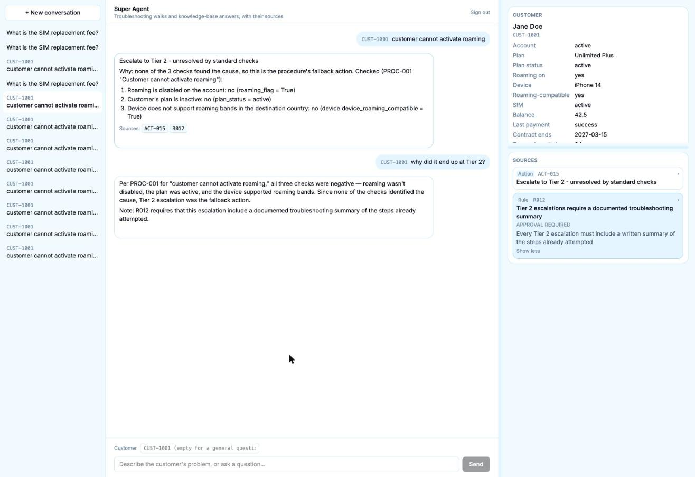

# Super Agent: a knowledge-graph copilot for call-centre troubleshooting

[](https://github.com/phanhpp/Knowledge-Graph-Call-center-Troubleshooting-Agent/actions/workflows/ci.yml)

A copilot for call-centre consultants. A consultant types a customer's problem; the agent checks the customer's account, decides what is being asked, and either **walks a troubleshooting procedure stored in a Neo4j knowledge graph** or **answers from a policy knowledge base with GraphRAG**. Every answer cites the actions, rules and articles it came from, read from the graph, never generated.

**Live demo:** [super-agent-silk.vercel.app](https://super-agent-silk.vercel.app) (password-protected: the password is available on request)

> Inspired by the published architecture of Vodafone's "Super Agent" consultant copilot. Not affiliated with Vodafone; all customers, procedures, rules and articles are synthetic.



## Highlights

- **Procedures and policy as graph data, not prompt text.** 20 troubleshooting procedures (57 steps, 28 conditions, 26 actions, 15 rules) live in Neo4j as `Step → Condition → API` and `Action → GOVERNED_BY → Rule` subgraphs. The walk is plain code: it follows `NEXT_STEP` edges and checks each condition against (mock) CRM APIs. An LLM is used only where language really needs reading: free-text tickets, with a retry when its confidence is low.
- **Citations come from the graph.** A troubleshooting answer cites its action and the rules governing it; a knowledge-base answer cites its articles and their rules. Code reads the IDs from Neo4j, so a citation can't be invented.
- **Hybrid GraphRAG.** Neo4j-native vector and full-text search over the knowledge base, then graph grounding (`Article → CITES_RULE → Rule`) to attach the governing rules.
- **Typed routing with a cautious fallback.** TypeSafe's Jev decision model returns probabilities, not prose, so routing is plain thresholds: an uncertain message goes to the knowledge base instead of a wrong procedure.
- **Online evaluation on every real conversation.** LangSmith code checks and Jev judges (made-up facts, contradictions, usefulness, retrieval relevance vs knowledge gaps), alerts to Slack, and consultant 👍 👎 on each answer.
- **Deployed and tested.** LangGraph Server on LangSmith Deployment with Neo4j Aura; a password-gated Next.js web app whose server-side proxy keeps the API key out of the browser; a Slack bot. 255 pytest (25 end-to-end with real model calls), 40 Vitest and 23 Playwright tests.

## Architecture

```
 Consultant ─┬─► Web app (Next.js 16)                       Slack (/agent, direct messages)
             │     proxy.ts: password gate                    slack_bot/: Socket Mode bot,
             │     /api/langgraph/[...path]: server-side      access limited to a private
             │       proxy, adds the API key                  channel's members
             │                  │                                         │
             └──────────────────┼─────────────────────────────────────────┘
                                ▼
            LangGraph Server (LangSmith Deployment)
              graph "super_agent": supervisor → troubleshooting walk | GraphRAG | explain
              custom routes: /customers/{id}  /sources/{id}  /feedback/{thread}
                                │
        ┌──────────────┬────────┴─────────┬───────────────────────────┐
        ▼              ▼                  ▼                           ▼
   Neo4j Aura     mock CRM APIs     Claude · OpenAI embeddings    LangSmith: traces, online
   (graph +       (data/*.json)     · TypeSafe Jev                evaluators, alerts → Slack,
   vector index)                                                  👍 👎 feedback
```

| Layer | Stack |
|---|---|
| Agent | Python 3.12, LangGraph (plain `StateGraph` nodes), Anthropic Claude, TypeSafe Jev |
| Knowledge graph & retrieval | Neo4j (Aura in the cloud), native vector + full-text indexes, `neo4j-graphrag` `HybridCypherRetriever`, OpenAI embeddings |
| Serving | LangGraph Server on LangSmith Deployment, custom Starlette routes |
| Web | Next.js 16, React 19, `@langchain/react` (`useStream`), Tailwind 4 |
| Slack | Slack Bolt, Socket Mode |
| Quality | LangSmith tracing, online evaluators and alerts; pytest, Vitest, Playwright; GitHub Actions data-integrity gate |

## Design decisions

| Decision | Why |
|---|---|
| Procedures and rules as graph nodes, not prompt text | Policy is enforced structurally: an action's governing rules are edges, so they can't be skipped or misremembered by a model. Conditions, actions and APIs are shared libraries referenced from many steps. |
| A deterministic walk; an LLM only for free-text tickets | Every other check is a known lookup, so code is faster, cheaper and auditable. Reading a ticket is language, so that one condition uses Claude, with a retry when it's unsure. |
| Citations read by code from Neo4j | A model can't cite a rule that doesn't exist. An online check (`citations_exist`) guards it anyway. |
| Jev for routing and judging | Typed probabilities, no parsing, about 0.3 s a call: routing thresholds and judge alerts are numbers you can tune. Jev never judges its own routing (that's checked offline). |
| Server-side proxy for the web app | The browser never sees the agent's URL or API key; the password is checked in `proxy.ts` and again in the proxy route. |
| Socket Mode for Slack | An internal tool with no public endpoint needed; the trade-off (a long-running process) is the reason HTTP mode is on the roadmap now the agent is deployed. |

## How a request flows

**Build** (run once, and again whenever `data/` changes):

```
  data/*.json   synthetic data, the source of truth
      |
      +--> etl/validate.py       checks IDs, links and cycles (needs no Neo4j)
      |
      +--> etl/load_to_neo4j.py  writes the Step, Condition, Action, API and Rule nodes and their links
      |
      +--> etl/load_articles.py  writes Article nodes with embeddings (OpenAI), linked to Rules

  etl/audit_graph.py checks that Neo4j still matches the JSON. GitHub Actions runs validate, load and
  audit on every pull request that touches data/, etl/ or mock_crm/.
```

**Answer** (every request). "Claude", "OpenAI" and "Jev" (TypeSafe's classifier) mark the model calls:

```
  consultant: message (+ customer ID, if it names one)
                      |
                      v
check_customer: only if the message names a customer ID,
  check it exists (mock_crm/crm_store.py); unknown: reply
  "I couldn't find a customer..." and stop
                      |
                      v
check_neo4j: is Neo4j reachable?
  no: reply "The knowledge graph is offline..." and stop
                      |
                      v
classify_intent (*MODEL: Jev*): what does consultant want done?
                      |
        +-------------+-------------+--------------------------------+
        |                           |                                |
 troubleshooting                open_ended                        explain
        |                           |                                |
        v                           |                                v
load_crm: customer's CRM record     |                              explain_answer
  (troubleshooting only); no        |                              (*MODEL: Claude*):
  customer yet: ask which one       |                              last 10 messages,
        |                           |                              those about a     
        v                           v                              customer labelled 
match_procedure (*MODEL: Jev*)      |                              with its ID, + the
  which of 20 procedures;           |                              rules' wording    
  "none" -> knowledge base -------->+                                |
        |                           |                                |
        v                           v                                |
procedural_executor             graph_rag_chain                      |
-------------------             ---------------                      |
start at step 1                 embed question (*MODEL: OpenAI*)     |
        |                           |                                |
        v                           v                                |
fetch_step                      search Article nodes in Neo4j        |
  Neo4j: step details             vector & fulltext search (top 5)   |
  conditions.json: condition        |                                |
        |                           v                                |
        v                       follow CITES_RULE to linked Rules    |
check the condition                 |                                |
  field/chain -> mock_crm           v                                |
  ticket text -> *MODEL: Claude*  *MODEL: Claude* writes answer      |
        |                           |                                |
        +-- YES -------> resolve    |                                |
        +-- NO (more) -> next step -+                                |
        |                (loop back)|                                |
        +-- NO (last) -> resolve    |                                |
                             |      |                                |
                             v      |                                |
                          resolve   |                                |
                             |      |                                |
                             +<-----+<-------------------------------+
                             |
                             v
answer + citations: action and rules, or articles and rules
  (an explanation cites none)

```

Example: customer `CUST-1001` asks "Customer cannot activate roaming". The answer is NO at steps 1, 2 and 3, so the agent replies with the action, why, and each step checked, citing `["ACT-015", "R012"]`:

```
Escalate to Tier 2 - unresolved by standard checks

Why: none of the 3 checks found the cause, so this is the procedure's fallback action.
Checked (PROC-001 "Customer cannot activate roaming"):
1. Roaming is disabled on the account: no (roaming_flag = True)
2. Customer's plan is inactive: no (plan_status = active)
3. Device does not support roaming bands in the destination country: no (device.device_roaming_compatible = True)
```

## The core idea: procedures as graph data

A **procedure** is a list of **steps** for one known problem. Each step asks one yes/no **condition** about the customer. An API checks the condition.

```
Procedure PROC-001  "Customer cannot activate roaming"

  Step 1  Condition: "Is roaming disabled?"     API check: GET /account/{customer_id}/roaming-status
            YES -> Action: "Enable roaming flag and inform customer of 10-minute activation delay"   STOP
            NO  -> go to Step 2

  Step 2  Condition: "Is the customer's plan inactive?"
            YES -> Action: "Direct customer to reactivate plan before roaming works"                 STOP
            NO  -> go to Step 3

  Step 3  Condition: "Does the device NOT support the destination's roaming bands?"   (last step)
            YES -> Action: "Explain that the device does not support the roaming bands ..."          STOP
            NO  -> Action: "Escalate to Tier 2 - unresolved by standard checks"
                   (every check passed, so nothing explains the problem: escalate, never "no action needed")
                   (only the last step has an action for NO, `action_if_false_id`, so a procedure always ends with an answer)
```

- **The API only checks** if a condition is true or false. The action is text that tells the consultant what to do.
- **YES** stops the procedure and gives that step's action. **NO** moves to the next step. On the last step, NO returns that step's fallback action (`action_if_false_id`)
- 3 types of conditions:
  - Field check: Reads a single CRM value to evaluate simple conditions directly (e.g., checking if roaming is disabled).
  - Chain check: Runs several lookups in a row, where one answer feeds the next (e.g. outage data is by zip code, so reads the customer's zip code from the CRM first, then looks up outages for that zip)
  - Ticket check: Uses an LLM to interpret free-text customer tickets, as unstructured human language cannot be parsed by static code.
- A **Rule** is a business policy governing how an action may be carried out: an approval it needs, an amount or time limit, something to never disclose, or a hard block. For example, "Tier 2 escalations require a documented troubleshooting summary". An action can be governed by several rules, and the answer cites each one.
- The final reply is the agent's last message: text with `citations` on the message (the action's ID, then the IDs of any rules governing it).


### Error handling


| Case                                | When it happens                                                                                                                                                    | What is returned                                                                                                                                                 | Where                                                    |
| ----------------------------------- | ------------------------------------------------------------------------------------------------------------------------------------------------------------------ | ---------------------------------------------------------------------------------------------------------------------------------------------------------------- | -------------------------------------------------------- |
| **Message B**                       | The agent can't find the matching procedure. For example, `match_procedure` returned an ID the graph does not have (the graph and `procedures.json` have drifted). | "I couldn't find a matching procedure for this request. Try rephrasing, or I can search the knowledge base instead." (`citations` is empty and `error` says why) | `handle_fetch_error`, `agent/procedural_executor.py:109` |
| **NO on the last step**             | The procedure was found and every step was checked. The last step's condition is false.                                                                            | fall back to 'action_if_false' defined for each procedure                                                                                                        | `resolve`, `agent/procedural_executor.py:162`            |
| **Unknown customer ID**             | The message names a customer ID that is not in the CRM. Checked first, before any paid model call; a message naming no customer is not checked.                    | "I couldn't find a customer with ID 'CUST-9999'. Check the customer ID and try again." (`citations` is empty and `error` says why)                               | `check_customer`, `agent/supervisor.py`                  |
| **No customer for troubleshooting** | A troubleshooting message, and no customer named yet in this conversation. A general question needs none.                                                          | "Which customer is this about? Start your message with their customer ID, …" (`error` says why)                                                                  | `load_crm`, `agent/supervisor.py`                        |
| **Neo4j down**                      | Neo4j is not reachable (not started, wrong password). Checked right after the customer, before any paid model call.                                                | "The knowledge graph is offline, so I can't answer right now. Ask whoever runs the agent to start Neo4j, then try again." (`error` gives the technical reason)   | `check_neo4j`, `agent/supervisor.py`                     |


### How it is stored in Neo4j

```
(Step)-[:HAS_CONDITION]->(Condition)-[:VALIDATED_BY]->(API)
(Step)-[:HAS_ACTION {outcome: true | false}]->(Action)-[:GOVERNED_BY]->(Rule)
(Step)-[:NEXT_STEP]->(Step)
(Article)-[:CITES_RULE]->(Rule)          knowledge-base articles
```

- There is no `Procedure` node. A procedure is every `Step` with the same `procedureId`, joined in order by `NEXT_STEP`.
- `API` nodes describe how a condition would be checked in production. The agent does not read them. It reads the steps, actions and rules from Neo4j and the full condition from `data/conditions.json`.

## What's in the citations

Every reply carries `citations`: the IDs of what the answer came from. They depend on which path answered:


| Reply comes from                                                                          | Citations                                                                                              | Example                               | Who produces them                                                                                      |
| ----------------------------------------------------------------------------------------- | ------------------------------------------------------------------------------------------------------ | ------------------------------------- | ------------------------------------------------------------------------------------------------------ |
| **Troubleshooting walk** (`resolve`)                                                      | the action given, then the rules governing it                                                          | `ACT-015, R012`; `ACT-027` (no rules) | code: the action ID from the step's `HAS_ACTION` link, the rule IDs via `GOVERNED_BY`, read from Neo4j |
| **Knowledge base** (`graph_rag_chain`)                                                    | each retrieved article, followed by the rules it cites (a rule cited by several articles appears once) | `KB-006, R004, KB-005, R005, R013, …` | code: from the search results, read from Neo4j                                                         |
| **Explain**                                                                               | nothing                                                                                                | —                                     | an explanation is not a new source; the answer it explains already showed its sources                  |
| **Fixed messages** (unknown customer, Neo4j down, "Which customer…?", no procedure found) | nothing                                                                                                | —                                     | —                                                                                                      |

## GraphRAG pipeline

```markdown
               Consultant Input: "What is the SIM replacement fee?"
                                        |
                                        v
                            1. Generate Embeddings
                 OpenAI text-embedding-3-small (1,536 dims)
                                        |
                                        v
                             2. Hybrid Search Engine
               Dual search across 25 Article nodes in Neo4j
                                        |
                       +----------------+----------------+
                       |                                 |
                 Vector Index                     Fulltext Index
             (Semantic Meaning)                  (Exact Keywords)
                       |                                 |
                       +----------------+----------------+
                                        |
                                        v
                          Scale & Merge Score Lists
                       Keep Top 5 Relevant Articles
                                        |
                                        v
                             3. Graph Grounding
              Traverse (Article)-[:CITES_RULE]->(Rule) in Neo4j
                     Extract linked governing Rule IDs
                                        |
                                        v
                            4. Answer Synthesis
                Claude Sonnet generates answer using ONLY
                      retrieved Articles & Rules
                                        |
                                        v
                            5. Consultant Response
                Deliver answer citing Article IDs + Rule IDs

```

## Jev

**Jev** (TypeSafe's classification model, via the `langchain-typesafe` package) is **a specialized LLM architecture (a "System One" classification model).**

It is not a traditional generative LLM (like GPT-4 or Claude) that predicts the next token to generate conversational text. Instead, **[Jev](https://docs.typesafe.ai/models?utm_source=gemini)** is an LLM trained exclusively to perform high-speed, structured probability estimations.

How it was trained: Instead of using RLHF (Reinforcement Learning from Human Feedbac) to align conversational text with human preferences, Jev uses RLCD (Reinforcement Learning for Calibrated Decisions)  to focus on making accurate decisions based on reliable probability estimates

Output: Instead of outputting text token like a chat LLM, Jev returns structured output: a label (typed answer), probability distribution for each option, and confidence score. You give it the current agent's state and one or more questions; it answers them all in one request.

Why it is used for routing:

- **Code can act on it directly.** The answer is a label plus numbers, so there is nothing to parse, and no risk of an answer outside the allowed labels.
- **Probabilities, so you choose the cut-off.** Code can say "walk a procedure only if troubleshooting is at least 50% likely", which is what makes a cautious fallback possible.
- **Fast and small.** In our logs a call takes about 0.3 s, and its output is a few numbers rather than generated text.

Its three kinds of question:


| Kind     | Asks                    | Returns                                                      | Use it for                                 |
| -------- | ----------------------- | ------------------------------------------------------------ | ------------------------------------------ |
| `Noul`   | Is this true?           | the probability of yes, 0 to 1                               | a clear yes/no `if` in code                |
| `Choice` | Which of these options? | the chosen label, a probability per label, a confidence      | sending each option down its own code path |
| `Score`  | Which level on a scale? | a score, the level descriptions, probabilities, a confidence | a spectrum, checked against a threshold    |


A `Noul` of 0.5 means yes and no are equally likely, not "medium", so use it only for a clearly defined yes/no; use `Score` for a level. Routing uses `Choice` (`classify_intent`, `match_procedure`); the online evaluators use `Noul` and `Score` (see Evaluation). Jev is an external service (`api.typesafe.ai`, `TYPESAFE_API_KEY`): the consultant's message is sent to it. The package is still in beta.

## Routing

Routing (`classify_intent`, then `match_procedure`, in `agent/supervisor.py`). Each is one Jev Choice, given only the consultant's latest message. It judges what the consultant wants done, not the topic: most procedures have a knowledge-base article on the same topic (cancellation, SIM replacement, outage credit). The procedure list is not shown at this point.

```
  the consultant's latest message only (not the conversation)
  |
  v
  one Jev Choice: what does the consultant want done? (not the topic)
  returns a label and a probability for each label,
  e.g. troubleshooting 0.96, open_ended 0.03, explain 0.01
  |
  v
  rules in plain code:
  troubleshooting, P(troubleshooting) >= 0.5  --> troubleshooting  --> match_procedure
  troubleshooting, P(troubleshooting) <  0.5  --> open_ended       --> knowledge base
  explain, on the first message               --> open_ended       --> knowledge base
  explain, after an earlier answer            --> explain          --> explain_answer
  open_ended                                  --> open_ended       --> knowledge base
```

- **Only the latest message.** Measured live, it classifies as well as the whole conversation, and it keeps earlier customers' messages and a growing history out of the Jev calls. The "nothing to explain on the first message" rule checks the saved conversation, which is still complete.
- **The probability, not the confidence.** The decision uses the chosen label's probability. Jev's `confidence` measures how concentrated the whole distribution is, which is harder to read: for "and the fee?" after a cancellation, confidence was 0.54 while open_ended's probability was 0.69.
- **The fee question** ("What are the early termination fees if I cancel my contract?") goes to the knowledge base (open_ended 0.92), the case the old Claude classifier got wrong.
- `match_procedure` is one Choice over the 20 procedures, each described by its name and `when_to_use` (`data/procedures.json`), plus "none". "none", or a confidence below 0.5, sends the message to the knowledge base instead of walking the nearest procedure.
- The 0.5 thresholds are starting values, set at the top of `agent/supervisor.py`. Tune them on a labelled set.

## Evaluation

LangSmith scores every real conversation automatically.

### Code checks: rules that must always hold

Score: **1** = OK, **0** = broken.


| Check                              | What it checks                                                                                  |
| ---------------------------------- | ----------------------------------------------------------------------------------------------- |
| `citations_exist`                  | Every source the reply cites (e.g. `ACT-015`, `R012`, `KB-006`) really exists.                  |
| `walk_has_checklist`               | A troubleshooting reply shows why, and the steps it checked.                                    |
| `troubleshooting_customer_handled` | Troubleshooting runs only when the customer is known; otherwise the bot asks "Which customer?". |


### AI judge (Jev): reads a reply and answers one question about it

Score: **0** = fine, **higher** = worse.


| Reply                     | Check                          | Question                                 | Score                              |
| ------------------------- | ------------------------------ | ---------------------------------------- | ---------------------------------- |
| Follow-up answer ("why?") | `explain_off_target`           | Did it fail to answer the question?      | 0 answered, 1 partly, 2 not at all |
|                           | `explain_made_up`              | Did it make up a fact?                   | 0 no … 1 yes                       |
|                           | `explain_contradicts_earlier`  | Did it contradict an earlier answer?     | 0 no … 1 yes                       |
| Knowledge-base answer     | `kb_unsupported_claim`         | Did it say something the articles don't? | 0 no … 1 yes                       |
|                           | `kb_unhelpful`                 | Is it hard to use on a live call?        | 0 usable, 1 partly, 2 not usable   |
| Articles the search found | `retrieval_unrelated_articles` | How many of the 5 are off-topic?         | 0 to 5 (3–4 is normal)             |
|                           | `retrieval_answer_missing`     | Is the answer missing from all of them?  | 0 no … 1 yes                       |


A "0 no … 1 yes" score is how sure Jev is that the answer is yes: near 0 means no, near 1 means yes, around 0.5 means it isn't sure.

## Web app (`web/`)

A Next.js app in front of the deployed agent:

- **Chat** with saved conversations (server threads, listed and reopened; the open one is in the URL), a **customer field** that stamps each message with its customer, and replies rendered as markdown.
- **Sources panel:** each reply's citation chips open their text: an action, a rule's wording, an article's opening. A source expands in place to its **full text** (fetched on demand from `/sources/{id}`, so saved conversations stay small).
- **Customer card:** the current customer's CRM record, read fresh from `/customers/{id}`.
- **👍 👎 on every answer**, written to LangSmith as feedback on the run that produced it, and read back after a reload.
- **Resizable panels** (drag or arrow keys, remembered per browser).
- **Security:** one shared password for now. `proxy.ts` sends anyone without the sign-in cookie to `/login`; the proxy route checks the cookie again before adding the LangSmith API key, so the key and the agent's URL never reach the browser. The cookie is `HttpOnly` and holds a hash, not the password.

Built with `@langchain/react`'s `useStream`. Two of its behaviours needed working around, both now covered by tests: a reply streamed live arrives without its `additional_kwargs` (so citations, sources and run ids are read from the thread's saved state after each turn), and a failed agent call sets no error (so a `fetch` wrapper reports it instead of leaving "Working on it…" forever).

## Using it in Slack

Start the bot with `uv run python -m slack_bot`. It needs Neo4j, the model keys and the two Slack tokens (setup: `slack_bot/slack_setup.md`). Then, in Slack:


|                            | `/agent` command                                    | Direct message to the bot                                 |
| -------------------------- | --------------------------------------------------- | --------------------------------------------------------- |
| Use it for                 | one quick question                                  | a conversation with follow-ups                            |
| Example                    | `/agent CUST-1005 customer cannot activate roaming` | `CUST-1005 customer cannot activate roaming`, then `why?` |
| Remembers earlier messages | no, every command starts from zero                  | yes, saved in `checkpoints.db`                            |
| Who sees the answer        | only you                                            | you                                                       |


- **Name the customer** when the message is about one. The ID can be anywhere in the text, in any case (`cust-1005` works). A general question ("what is the SIM replacement fee?") needs none. A troubleshooting message with no customer gets "Which customer is this about?".
- **In a DM**, follow-ups about the same customer need no ID. Naming another ID switches customer and keeps the conversation. A thread inside the DM is a separate conversation, so you can work two cases side by side.
- Every answer ends with its sources, e.g. `_Sources: ACT-015, R012_`.
- **Who can use it:** members of the private channel in `SLACK_MEMBERS_CHANNEL`, plus any user IDs in `SLACK_ALLOWED_USERS`. With neither set, anyone in the workspace can.

More in `slack_bot/README.md`.

### How a Slack command reaches the agent

 Slack never talks to Neo4j or the agent directly. Only the bot process talks to Slack, and it calls the agent as a normal Python function:

```
 Slack workspace
   |  consultant types: /agent CUST-1005 customer cannot activate roaming
   |
   |  (1) Slack pushes the command over a websocket that the bot opened itself (app token, xapp-)
   v
 slack_bot/app.py       one Python process on your machine: uv run python -m slack_bot
   |                    acknowledges within Slack's 3 seconds ("Checking..."), then splits the text
   |                    into customer_id "CUST-1005" and the question
   |
   |  (2) ask(question, customer_id)          an ordinary function call in the same process
   v
 agent/supervisor.py    the same graph as above
   |
   +--> Neo4j           steps, actions, rules, KB articles (the URI in .env)
   +--> data/*.json     CRM records and conditions
   +--> Claude, OpenAI  the language-model calls
   |
   |  (3) returns {"answer": ..., "citations": [...]}
   v
 slack_bot/app.py       formats it as a Slack message
   |
   |  (4) sends it to the reply URL Slack included with the command, replacing "Checking..."
   v
 Slack workspace        only the person who typed the command sees the reply
```

A direct message goes the same way, through `slack_bot/chat.py`: the DM (or a thread inside it) is the `thread_id`, and the graph is compiled with the SQLite checkpointer, so the messages (each stamped with its customer) and the current customer are saved between messages. A message naming a different customer switches to them; the conversation is kept.

## Testing

| Suite | What it covers | Count |
|---|---|---|
| **pytest** | data validation, the condition evaluator, the walk, routing, GraphRAG, explain, the custom routes, the Slack bot (fake Slack events), the online code evaluators, the offline walks and routing suites | 255 tests; 25 of them end-to-end with real Neo4j and model calls (`-m e2e`) |
| **Vitest** (`web/`) | the password gate, message formats, panel sizes, the feedback and full-source hooks | 40 |
| **Playwright** (`web/`) | the real Next.js server against a **fake agent replaying traffic recorded from the real one**: sign-in, citations, sources, the customer card, sending, feedback, failures, resizing and expanding | 23 |
| **GitHub Actions** | **CI** on every pull request, required before merging to `main`: the web app (type check, Vitest, Playwright) and the agent (import check with the deployed dependencies only, then the fast pytest suite on Python 3.12 against a throwaway Neo4j). **Data integrity** on pull requests touching the data: validate the JSON, load it over the base branch's graph, audit the result | — |
| **Smoke test** | `deploy/smoke.py`: one real conversation and every custom route, against a local or deployed server | 11 checks |

The online evaluators (above) keep checking real traffic after deployment. Every suite, file by file, and the bugs each one pins: [TESTING.md](TESTING.md).

## Run it locally

You need Python 3.12+, [uv](https://docs.astral.sh/uv/), Node 24 with pnpm, and Neo4j 5.18.1+ (local or [Aura](https://neo4j.com/cloud/aura/)). Copy `.env.example` to `.env` and fill it in.

```bash
uv sync
uv run python -m etl.validate        # checks data/ (no Neo4j, no keys)
uv run python -m etl.load_to_neo4j   # builds the graph
uv run python -m etl.audit_graph     # checks the graph matches data/
uv run python -m etl.load_articles   # embeds the knowledge-base articles (OPENAI_API_KEY)
uv run pytest -m "not e2e"           # fast tests; drop the -m to include the 25 end-to-end tests

uv run langgraph dev                 # the agent server on :2024 (graph + custom routes)
uv run python deploy/smoke.py        # one real conversation and every route, against it

cd web && cp .env.local.example .env.local   # AGENT_SERVER_URL=http://127.0.0.1:2024, WEB_PASSWORD=…
pnpm install && pnpm dev             # the web app on :4200
pnpm test && pnpm test:e2e           # Vitest, then Playwright

uv run python -m slack_bot           # the Slack bot (needs Slack tokens, see slack_bot/slack_setup.md)
```

Claude features need `ANTHROPIC_API_KEY`, embeddings `OPENAI_API_KEY`, routing `TYPESAFE_API_KEY`; tests that need a missing key are skipped.

## Deployment

- **Agent:** `langgraph.json` serves `agent/graph.py:graph` as `super_agent`, with the custom routes from `agent/http_app.py`, on LangSmith Deployment (built from GitHub on push; Python 3.12; the package list in `pyproject.toml` decides what's in the image). Its secrets are the model keys and the four `NEO4J_*` settings for Aura.
- **Graph:** Neo4j Aura, loaded with the same `etl` scripts.
- **Check a deployment:** `uv run python deploy/smoke.py --url <deployment URL>` (sends `LANGSMITH_API_KEY`).
- **Web app:** on Vercel ([live](https://super-agent-silk.vercel.app)), root `web/`, with `AGENT_SERVER_URL`, `LANGSMITH_API_KEY` and `WEB_PASSWORD` as environment variables.

## Roadmap

- Slack over HTTP, through the same proxy as the web app, verified by Slack's request signature (no long-running process).
- Per-user sign-in, with each consultant seeing only their own conversations.
- Calibrate the Jev judges' thresholds on hand-labelled runs, and small offline test sets (routing, retrieval recall@5).
- Human-in-the-loop for low-confidence ticket readings: pause and ask the consultant instead of guessing.

## Project structure

```
.
├── agent/                      the LangGraph agent
│   ├── supervisor.py           the main graph: customer check, Neo4j check, routing (Jev), explain
│   ├── procedural_executor.py  the troubleshooting walk: a subgraph that follows a procedure step by step
│   ├── ticket_interpreter.py   Claude reads a customer's ticket (ticket conditions only)
│   ├── graph_rag_chain.py      the knowledge-base path: hybrid search, graph grounding, Claude answers
│   ├── sources.py              the text behind each cited ID (short on replies, full on request)
│   ├── utils.py                reply(): an answer with its citations, sources and run id
│   ├── graph.py, http_app.py   what LangGraph Server serves: the graph and the custom routes
│   └── routes/                 /customers, /sources, /feedback
├── data/                       synthetic JSON, the source of truth: CRM, conditions, actions,
│                               procedures, rules, knowledge-base articles
├── etl/                        validate, load into Neo4j, embed the articles, audit the graph
├── mock_crm/                   the fake CRM and lookup APIs the walk verifies conditions against
├── slack_bot/                  the Slack front end (Bolt, Socket Mode)
├── web/                        the Next.js web app, with its Vitest and Playwright tests
├── eval/                       the evaluation plan and the online code evaluators
├── deploy/smoke.py             end-to-end check of a running server
├── tests/                      pytest: unit, integration, and e2e/ with real models
├── langgraph.json              how LangGraph Server serves the agent
└── config.py                   settings, the Neo4j driver and its traced connectivity check
```

## License

MIT — see [LICENSE](LICENSE).
