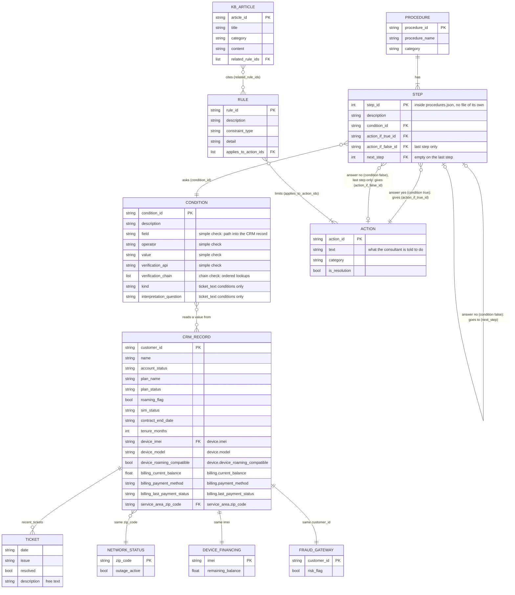

# mock_crm

This folder answers yes/no questions about a customer, for example "is there an outage where they live?" or "do they still owe money on their phone?".

In the real system these answers come from the company's CRM and other internal systems. This project has no access to those, so each one is replaced here by a JSON file in `data/`. Nothing calls the network, and nothing here changes any data. It only reads.

## Terms used below

- **CRM record**: everything we know about one customer (ID, plan, device, ZIP code and so on). Stored in `data/crm_records.json`, 60 customers.
- **IMEI**: a 15-digit number that identifies one physical phone (the handset). It is not the SIM card and not the phone number. Each customer's record holds the IMEI of their device (`device.imei`), and it is the key for the device-financing lookup.
- **Condition**: one yes/no question, stored in `data/conditions.json`. Example: `COND-001` is "is roaming disabled?".
- **Procedure**: a list of steps a consultant follows to fix a problem. Each step asks one condition, and the answer is **yes** when the condition is true for this customer (for example, their roaming really is disabled) or **no** when it is false. On yes, the procedure stops and gives the consultant that step's action. On no, it moves on to the next step. The last step has an action for no too, so a procedure always ends with an answer.

This folder's job is to answer a condition for a given customer: yes (`True`) or no (`False`).

## How the data files connect

Every file in `data/` is a list of records. Records in one file point to records in another by ID, so the files together describe one connected graph. Here are all the files and how they link:

In the labels, "yes" means the step's condition is true for this customer and "no" means it is false. A step only follows `next_step` on no. On yes, the procedure stops at that step.

How to read the symbols: the symbol next to a box says how many of that box one item on the other side connects to. `||` is exactly one, `o|` or `|o` is zero or one, `|{` or `}|` is one or more, and `o{` or `}o` is zero or more. For example, `STEP }o--|| CONDITION` means each step asks exactly one condition, and one condition can be asked by zero or more steps.

Some attribute names use underscores where the real JSON is nested. `device_imei` is `device.imei` in `crm_records.json`, and the quoted note on each one gives the real path. `TICKET` is not a file. It is the `recent_tickets` list inside each CRM record.

### The links, one by one

| From (file and field) | To (file and field) | What they share |
|---|---|---|
| `procedures.json` step `condition_id` | `conditions.json` `condition_id` | A condition ID |
| `procedures.json` step `action_if_true_id`, `action_if_false_id` | `actions.json` `action_id` | An action ID |
| `procedures.json` step `next_step` | `step_id` of another step in the same procedure | A step number |
| `rules.json` `applies_to_action_ids` | `actions.json` `action_id` | A list of action IDs |
| `kb_articles.json` `related_rule_ids` | `rules.json` `rule_id` | A list of rule IDs |
| `conditions.json` `field` | A field in `crm_records.json`, written as a path such as `device.imei` | A field path |
| `conditions.json` `verification_chain` | A CRM field path, or one of the three lookup files below | A field path, then the value from the step before |
| `crm_records.json` `service_area.zip_code` | `network_status.json` `zip_code` | A ZIP code |
| `crm_records.json` `device.imei` | `device_financing.json` `imei` | A device IMEI |
| `crm_records.json` `customer_id` | `fraud_gateway.json` `customer_id` | A customer ID |

The last three links are only used by chain conditions: `COND-023` (network), `COND-025` (financing) and `COND-026` (fraud). Conditions and actions are stored once and referenced by ID, so many steps can share the same one.

The current data has 60 customers, 20 procedures, 28 conditions, 26 actions, 15 rules and 25 KB articles. The 60 customers share only 10 ZIP codes, so several customers can point to the same network status record. Each customer has exactly one financing record and one fraud record.

An ID typed wrongly in one file breaks the link silently, so `etl/validate.py` checks the ID links before the data is loaded. It checks the step-to-condition, step-to-action, next-step, rule-to-action and article-to-rule links. It does not check the three CRM-to-lookup links above.

### Example: following one procedure

`PROC-001` ("Customer cannot activate roaming") has three steps:

1. **Step 1** asks `COND-001` ("Roaming is disabled on the account"). Yes means roaming is disabled: the procedure stops and the consultant gets `ACT-001` ("Enable roaming flag and inform customer of 10-minute activation delay"). No means roaming is already enabled: go to step 2.
2. **Step 2** asks `COND-003` ("Customer's plan is inactive"). Yes: stop and give `ACT-002`. No: go to step 3.
3. **Step 3** is the last step. It asks `COND-007` ("Device supports roaming bands"). Yes: stop and give `ACT-019` ("Confirm device is roaming-compatible; no further action needed"). No: there is no next step, so the consultant gets `ACT-015` ("Escalate to Tier 2 - unresolved by standard checks").

Rules and articles sit beside this path. For example, rule `R001` ("Refunds over $50 require supervisor approval") limits action `ACT-016`, and article `KB-001` cites rule `R006`.

## The two kinds of condition it answers

**1. Simple check.** Compare one field of the CRM record with a value.

`COND-001` says: `roaming_flag == false`. The code reads `roaming_flag` from the customer's record, compares it to `false`, and returns `True` or `False`.

**2. Chain check.** One field isn't enough, so several lookups run in order. Each lookup uses the result of the one before it.

`COND-023` asks "is there an active outage where the customer lives?". For customer `CUST-1001`:

1. Read `service_area.zip_code` from the CRM record. The result is `94103`.
2. Look up `94103` in `data/network_status.json`. It has `outage_active: true`.
3. The condition needs `outage_active == true`. It is, so the answer is `True`.

The steps of a chain are written down in `conditions.json` under `verification_chain`. The code never decides at runtime which lookups to make.

A third kind, `ticket_text`, means reading a free-text support ticket. That needs a language model, so it is handled in `agent/ticket_interpreter.py`, not here.

## Files

| File | Data file it reads | What it does |
|---|---|---|
| `crm_store.py` | `crm_records.json` | `get_customer(customer_id)` returns the customer's CRM record. |
| `network_status_store.py` | `network_status.json` | `get_network_status(zip_code)` says whether an outage is active in that ZIP. |
| `device_financing_store.py` | `device_financing.json` | `get_device_financing(imei)` returns how much the customer still owes on the device. |
| `fraud_gateway_store.py` | `fraud_gateway.json` | `get_fraud_status(customer_id)` says whether the account is flagged as high fraud risk. |
| `condition_evaluator.py` | `conditions.json` | Answers a condition. Runs the simple check or the chain check depending on the condition. |

The four `*_store.py` files all work the same way. They load their JSON file once, keep it in memory, and look records up by key. If the key isn't found they raise an error named after the lookup, for example `ZipNotFoundError`.

## Inside `condition_evaluator.py`

| Function | What it does |
|---|---|
| `get_condition(condition_id)` | Returns the full condition from `conditions.json`. |
| `resolve_condition(record, condition)` | The one function other code calls. It picks the simple or chain check for that condition. |
| `evaluate_condition(record, condition)` | The simple check. |
| `evaluate_chain_condition(record, condition)` | The chain check. |
| `get_nested_field(record, "device.imei")` | Reads a value from inside the record, following the dots. Raises `FieldNotFoundError` if a part of the path is missing. |

Values are compared with `==`, `!=`, `>`, `<`, `>=` and `<=`. The code converts types where it can, so a text `"true"` matches a real `true`, and a list is compared by its length. It never uses `eval()`.

`CHAIN_SOURCES` in this file maps each chain step's `source` name (`network_status`, `device_financing`, `fraud_gateway`) to the store function that looks it up. A chain step with `source: crm` reads from the customer's record instead.

## Who uses this folder

- `agent/supervisor.py` calls `get_customer()` once at the start of a request and keeps the CRM record.
- `agent/procedural_executor.py` calls `get_condition()` and `resolve_condition()` at each procedure step.
- `etl/validate.py` uses `CHAIN_SOURCES` to check `conditions.json` before the data is loaded.

## Adding another mock lookup

1. Add `data/<name>.json` and `mock_crm/<name>_store.py`. Copy an existing store.
2. Add one line for it in `CHAIN_SOURCES` in `condition_evaluator.py`.
3. Use it as a `source` in a condition's `verification_chain` in `conditions.json`.

## What is checked, and what isn't

Before loading, `etl/validate.py` checks each chain:

- it has at least 2 steps;
- every `source` is `crm` or a name in `CHAIN_SOURCES`;
- every `param_from` (the value a step looks up) comes from an earlier step;
- every `crm` step reads a field that exists in the CRM record.

It does not check that the values being looked up exist in the store's data. If a customer's ZIP code is missing from `network_status.json`, the error only appears when that condition is evaluated.

Tests are in `tests/test_condition_evaluator.py`. They cover simple checks (including type conversion, list fields and the error cases) and yes/no results for all three chain conditions. They do not yet cover chain error cases, such as an unknown `source` or a missing key.
